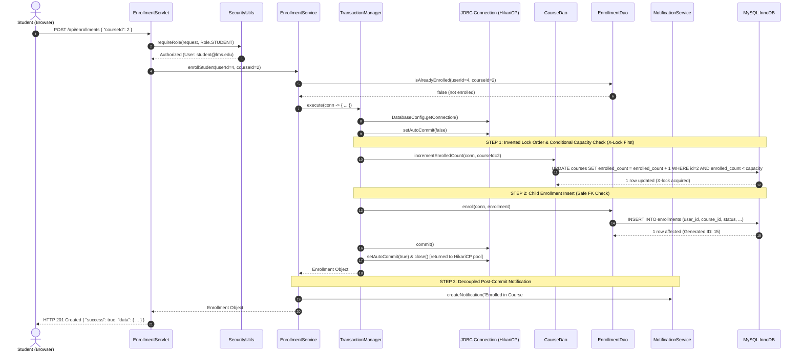

# System Architecture & Technical Design Document
### Online Learning Management System (LMS)
**Course:** 3rd-Semester CSE Java Web-Based Project  
**Author:** Student Engineering Team  

---

## 1. Architectural Overview

The Online Learning Management System (LMS) is engineered following a clean, decoupled **4-Tier Layered Architecture**. The system deliberately avoids heavy abstraction frameworks (such as Spring Boot, Spring Data JPA, or Hibernate ORM) in order to expose and master the core fundamentals of web computing: **Jakarta Servlets 6.0**, **Java Database Connectivity (JDBC 4.x)**, **Connection Pooling via HikariCP**, and **Core Object-Oriented Java**.

```
+-----------------------------------------------------------------------------------------+
|                                TIER 1: PRESENTATION TIER                                |
|  - React 18 + TypeScript + Tailwind CSS Single-Page Application (SPA)                   |
|  - Role-specific dynamic portals (Student, Instructor, Administrator)                   |
|  - HTTP client communicating with backend using JSON payloads over standard REST routes |
+-----------------------------------------------------------------------------------------+
                                             |
                                 HTTP / JSON Requests
                                             v
+-----------------------------------------------------------------------------------------+
|                           TIER 2: SERVLET CONTROLLER TIER                               |
|  - Apache Tomcat 10.1 Web Container (Port 8080)                                         |
|  - Jakarta Servlet 6.0 Endpoints inheriting from BaseServlet                            |
|  - Filters: CorsFilter, EncodingFilter (UTF-8)                                          |
|  - Security & Session Management: SecurityUtils (Role enforcement, session cookies)     |
|  - Jackson Databind for bidirectional JSON serialization                                |
+-----------------------------------------------------------------------------------------+
                                             |
                                  Direct Java Method Calls
                                             v
+-----------------------------------------------------------------------------------------+
|                             TIER 3: BUSINESS SERVICE TIER                               |
|  - 13 Domain Services implementing fine-grained LMS business logic                      |
|  - AppContext Pure-Java Dependency Injection and Singleton Registry                     |
|  - Business Validations (ownership, capacity, duplicate enrollment, grading bounds)     |
|  - Explicit JDBC Transaction Demarcation (setAutoCommit(false), commit(), rollback())    |
+-----------------------------------------------------------------------------------------+
                                             |
                                     DAO Interface Calls
                                             v
+-----------------------------------------------------------------------------------------+
|                           TIER 4: DATA ACCESS OBJECT (JDBC) TIER                        |
|  - 11 DAO Interfaces separating persistence contracts from storage logic                |
|  - 100% Parameterized PreparedStatements (Total SQL Injection Prevention)               |
|  - Try-with-resources AutoCloseable resource management                                 |
|  - HikariCP Connection Pool (Zero-overhead connection acquisition)                      |
|  - Dual Database Failover: Production MySQL 8.x + Embedded H2 Database                  |
+-----------------------------------------------------------------------------------------+
                                             |
                                      SQL Protocol
                                             v
+-----------------------------------------------------------------------------------------+
|                                    PERSISTENCE TIER                                     |
|  - 14 Relational Tables normalized to Third Normal Form (3NF)                           |
|  - Foreign Key Constraints with ON DELETE CASCADE rules                                 |
+-----------------------------------------------------------------------------------------+
```

---

## 2. Detailed Layer Breakdown

### 2.1 Presentation Tier (Client)
* **Technology:** React 18, TypeScript, Tailwind CSS, Lucide Icons, Vite build pipeline.
* **Responsibilities:**
  * Renders responsive, accessible, interactive user dashboards.
  * Manages client-side routing and view state.
  * Translates user events into asynchronous `fetch()` API calls with JSON bodies.
  * Includes a built-in **Viva Evaluation Bar** allowing academic evaluators to switch roles between Student (`student@lms.edu`), Instructor (`instructor@lms.edu`), and Admin (`admin@lms.edu`) with a single click.

### 2.2 Servlet Controller Tier
* **Technology:** Jakarta Servlet Specification 6.0 (`jakarta.servlet.http.HttpServlet`).
* **Responsibilities:**
  * Intercepts HTTP requests (`doGet`, `doPost`, `doPut`, `doDelete`).
  * Deserializes JSON payloads into strongly-typed DTOs using Jackson `ObjectMapper`.
  * Enforces authentication and authorization checks via `SecurityUtils`.
  * Dispatches work to the appropriate Service interface.
  * Serializes responses into standard JSON envelopes:
    ```json
    {
      "success": true,
      "message": "Operation successful",
      "data": { ... },
      "timestamp": 1791909126637
    }
    ```
  * Centralizes exception handling in `BaseServlet.handleException()`, translating checked exceptions into correct HTTP status codes (`400 Bad Request`, `401 Unauthorized`, `403 Forbidden`, `404 Not Found`, `500 Internal Server Error`).

### 2.3 Business Service Tier
* **Technology:** Pure Java (JDK 17+) interfaces and implementations.
* **Responsibilities:**
  * Enforces domain rules (e.g. course capacity check, duplicate enrollment check, assignment submission deadline verification, grading range validation).
  * Enforces resource ownership (e.g. instructors cannot edit courses owned by other instructors).
  * Coordinates multi-table modifications and controls database transactions.
  * Decouples business rules from HTTP servlet concerns and SQL queries.

### 2.4 Data Access Object (DAO) Tier
* **Technology:** JDBC 4.x (`java.sql.Connection`, `java.sql.PreparedStatement`, `java.sql.ResultSet`).
* **Responsibilities:**
  * Encapsulates all SQL logic behind interface contracts (`UserDao`, `CourseDao`, `EnrollmentDao`, etc.).
  * Uses 100% parameterized queries (`?`) to guarantee immunity from SQL Injection attacks.
  * Employs Java try-with-resources to guarantee deterministic release of JDBC connections, statements, and result sets.
  * Maps relational tuples from `ResultSet` into strongly typed domain model objects.
  * Supports overloaded connection signatures (e.g., `enroll(Connection conn, ...)`), allowing the Service tier to pass an existing transactional connection across multiple DAO invocations.

---

## 3. Transaction Management & Concurrency Architecture

A crucial requirement in enterprise database engineering is maintaining ACID (Atomicity, Consistency, Isolation, Durability) guarantees across composite operations while eliminating race conditions and deadlocks under concurrent access.

In this application, transaction boundaries are strictly managed at the **Business Service Tier** using pure JDBC without Spring's `@Transactional` or ORM magic. To eliminate boilerplate and enforce uniform transaction semantics, a reusable functional helper, `TransactionManager`, is employed across all multi-step workflows.

### 3.1 Reusable `TransactionManager` Pattern

The `TransactionManager` executes functional database callbacks within an explicit transactional scope:
1. Disables auto-commit (`conn.setAutoCommit(false)`).
2. Executes the supplied business lambda (`TransactionCallback<T>`).
3. Commits the transaction (`conn.commit()`).
4. On failure, triggers `conn.rollback()` while attaching any rollback failure to the primary exception via `ex.addSuppressed(rollbackEx)`.
5. Automatically retries the unit of work once upon detecting an InnoDB transient deadlock (`MySQL Error 1213` / `SQLState 40001`).
6. Restores auto-commit and deterministically returns the connection to HikariCP in a `finally` block.

```java
// Reusable template implementation from com.lms.util.TransactionManager:
public static <T> T execute(TransactionCallback<T> callback) {
    int attempts = 0;
    while (true) {
        attempts++;
        Connection conn = null;
        try {
            conn = DatabaseConfig.getConnection();
            conn.setAutoCommit(false);

            T result = callback.doInTransaction(conn);

            conn.commit();
            return result;
        } catch (SQLException ex) {
            boolean isDeadlock = (ex.getErrorCode() == 1213) || "40001".equals(ex.getSQLState());
            if (conn != null) {
                try {
                    conn.rollback();
                } catch (SQLException rollbackEx) {
                    ex.addSuppressed(rollbackEx);
                }
            }
            if (isDeadlock && attempts < MAX_DEADLOCK_RETRIES) {
                LOGGER.warn("InnoDB deadlock encountered (1213/40001). Retrying transaction...");
                continue;
            }
            throw new LmsException("Database transaction failed: " + ex.getMessage(), ex);
        } finally {
            if (conn != null) {
                try {
                    conn.setAutoCommit(true);
                    conn.close(); // Deterministic return to HikariCP pool
                } catch (SQLException ex) {
                    LOGGER.error("Failed to close JDBC connection", ex);
                }
            }
        }
    }
}
```

### 3.2 InnoDB Foreign-Key Deadlock Analysis & Lock-Order Inversion

Under MySQL InnoDB, foreign-key relationships introduce subtle lock escalation that can easily induce deadlocks if operation ordering is not carefully designed.

#### The Problem: Lock Escalation Deadlock
In a naive enrollment implementation:
1. Transaction 1 executes `INSERT INTO enrollments (...)`. InnoDB automatically acquires a **Shared Lock (S-lock)** on the referenced parent row in `courses` to verify foreign key integrity.
2. Concurrent Transaction 2 executes `INSERT INTO enrollments (...)` for the same course and acquires an S-lock on the same `courses` row.
3. Transaction 1 proceeds to execute `UPDATE courses SET enrolled_count = enrolled_count + 1 WHERE id = ?`. To update the row, it must upgrade its lock to an **Exclusive Lock (X-lock)**. However, Transaction 1 is blocked because Transaction 2 still holds an S-lock on that row.
4. Transaction 2 proceeds to execute its `UPDATE courses` statement and also requests an X-lock on the course row. It is blocked waiting for Transaction 1's S-lock.
5. **Result:** Circular wait deadlock. MySQL InnoDB detects the cycle and terminates one transaction with `ERROR 1213 (40001): Deadlock found when trying to get lock; try restarting transaction`.

#### The Architectural Solution: Inverted Lock Ordering
To completely prevent this deadlock, the enrollment operation inverts the lock acquisition order:
1. **Step 1 (Exclusive Lock First):** Execute `CourseDao.incrementEnrolledCount(conn, courseId)` *before* inserting into `enrollments`. Because an `UPDATE` requires an X-lock immediately:
   * The first transaction instantly acquires the X-lock on the course row.
   * Any competing concurrent transaction attempting to enroll in the same course immediately blocks at the row level without deadlock.
2. **Step 2 (Safe Child Insert):** The holding transaction then executes `EnrollmentDao.enroll(conn, enrollment)`. The foreign-key S-lock check succeeds without conflict because the current transaction already owns the parent row's X-lock.
3. **Step 3 (Commit & Release):** When `conn.commit()` executes, the X-lock is released. The waiting transaction wakes up cleanly and executes sequentially.

### 3.3 Conditional Capacity Enforcement (No Overselling)

To prevent overselling seats when multiple students enroll concurrently, capacity is strictly enforced atomically inside the database engine:

```sql
UPDATE courses 
SET enrolled_count = enrolled_count + 1 
WHERE id = ? AND enrolled_count < capacity
```

The Service layer inspects the return value of `executeUpdate()`:
- If `rowsUpdated == 1`: Seat reservation succeeded.
- If `rowsUpdated == 0`: The course is already at maximum capacity. The service immediately throws a domain `CourseFullException`, which `BaseServlet` maps to `HTTP 400 Bad Request`.

### 3.4 Decoupled Post-Commit Notification

Email or in-app notification dispatch (`NotificationService.sendNotification`) is deliberately decoupled from the JDBC database transaction:
* Executing notification delivery *inside* the transaction would hold database locks open during network/IO operations.
* A transient failure in notification delivery should **never** roll back an otherwise valid course enrollment.
* Therefore, notifications are dispatched as a post-commit best-effort step.

### 3.5 Symmetric Course Drop Path

To maintain relational integrity when students unenroll, a symmetric `dropCourse(studentId, courseId)` method is provided:
1. `TransactionManager.execute(...)` is opened.
2. `enrollmentDao.updateStatus(conn, studentId, courseId, EnrollmentStatus.DROPPED)` updates the record.
3. `courseDao.decrementEnrolledCount(conn, courseId)` conditionally reduces the enrolled count (`WHERE id = ? AND enrolled_count > 0`).
4. Changes commit atomically.

---

## 4. Sequence Diagram: Deadlock-Free Course Enrollment Flow



---

## 5. Core Java OOP Design Architecture

The application was intentionally constructed to demonstrate fundamental Object-Oriented Programming (OOP) concepts without synthetic or artificial classes:

### 5.1 Encapsulation
All entity domain models (`User`, `Course`, `Module`, `Lesson`, `Assignment`, `Submission`, `Quiz`) feature strictly `private` fields. State is modified exclusively via public getters and setters with internal sanity checks (e.g., verifying capacity is positive, email format matches valid pattern).

### 5.2 Inheritance
A unified `User` abstract class encapsulates shared user attributes (`id`, `email`, `passwordHash`, `firstName`, `lastName`, `role`, `status`, `createdAt`):
* `StudentUser extends User` adds `studentId`, `major`, `yearOfStudy`.
* `InstructorUser extends User` adds `instructorCode`, `department`, `officeLocation`.
* `AdminUser extends User` adds `adminLevel`, `superAdminFlag`.

### 5.3 Runtime Polymorphism
* **Method Overriding:** The abstract `User` class declares abstract methods `getRoleDashboardUrl()` and `hasAdministrativePrivileges()`. Each subclass overrides these methods to supply specialized, polymorphic behavior at runtime.
* **Strategy Pattern:** The grading calculation system demonstrates interchangeable polymorphic algorithms via the `GradingStrategy` interface:
  * `StandardGradingStrategy`: Direct point summation.
  * `WeightedGradingStrategy`: Weighted percentage distribution across assignments and quizzes.

### 5.4 Abstraction & Interfaces
Every major capability is defined as a Java `interface` prior to implementation:
* DAO Interfaces (`UserDao`, `CourseDao`, `AssignmentDao`, `QuizDao`, etc.).
* Service Interfaces (`UserService`, `CourseService`, `EnrollmentService`, etc.).
This guarantees loose coupling and allows the system to switch database implementations (e.g., MySQL vs H2) seamlessly.

### 5.5 Exception Handling Hierarchy
A domain-specific checked/unchecked exception hierarchy rooted at `LmsException`:
* `LmsException` (Base Runtime Exception)
  * `AuthenticationException` (Invalid credentials, expired sessions)
  * `UnauthorizedException` (Role permission violation)
  * `ResourceNotFoundException` (Course/User/Assignment not found)
  * `ValidationException` (Invalid user input or business rule breach)

---

## 6. Security Architecture

1. **Password Hashing:** Passwords are never stored in plaintext. Passwords use BCrypt with a cost factor of 12 (`BCrypt.hashpw(plain, BCrypt.gensalt(12))`), protecting against rainbow table and brute-force attacks.
2. **Session-Based Authentication:** Standard Jakarta `HttpSession` is utilized with `HttpOnly` and `SameSite` flags. Sessions are explicitly invalidated on logout via `session.invalidate()`.
3. **Role-Based Access Control (RBAC):** Every incoming request to protected Servlet endpoints validates user session and permissions:
   * Public: `/api/auth/login`, `/api/auth/register`, `/api/courses` (catalog view)
   * Student only: `/api/enrollments` (create), `/api/submissions` (submit), `/api/quizzes/attempt`
   * Instructor only: `/api/courses` (create/update), `/api/assignments` (create), `/api/submissions/grade`
   * Admin only: `/api/users` (create/toggle), `/api/audit-logs`, `/api/system-settings`
4. **SQL Injection Defense:** Zero dynamic SQL string concatenation is permitted. All queries are executed using `java.sql.PreparedStatement`.
5. **Cross-Origin Resource Sharing (CORS):** Managed via `CorsFilter` specifying exact headers, methods, and credentials options.
