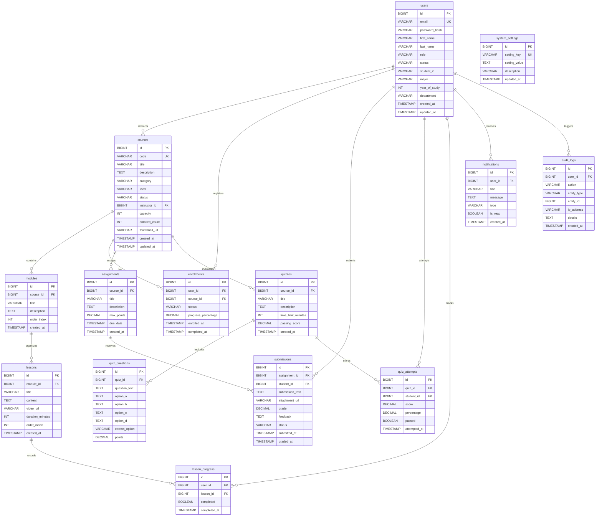

# Database Design & Entity-Relationship Document (ERD)
### Online Learning Management System (LMS)
**Course:** 3rd-Semester CSE Java Web-Based Project  
**Database Engine:** MySQL 8.x (with H2 Database in MySQL mode fallback)  

---

## 1. Relational Schema Overview & Normalization

The database architecture is designed in strict compliance with **Third Normal Form (3NF)** rules:
1. **First Normal Form (1NF):** All attributes contain atomic values; no multi-valued columns or repeating groups exist.
2. **Second Normal Form (2NF):** All non-key attributes are fully functionally dependent on the entire primary key.
3. **Third Normal Form (3NF):** No transitive dependencies exist (non-key attributes do not depend on other non-key attributes).

The schema comprises **14 relational tables** enforcing referential integrity with foreign keys, unique constraints, and indexes.

### Documented Deliberate Denormalizations & Tradeoff Analysis
Rather than claiming theoretical "pure 3NF", the system architecture is **normalized to 3NF with documented, deliberate denormalizations** engineered to eliminate deadlocks, guarantee atomic seat capacity, and optimize read latency:

| Column / Structure | Apparent 3NF Violation | Engineering Rationale & Performance Benefit | Consistency & ACID Maintenance Strategy |
| :--- | :--- | :--- | :--- |
| `courses.enrolled_count` | Derived from `COUNT(enrollments)` | **Counter Cache Pattern:** Makes seat capacity enforcement an $O(1)$ single-row atomic row lock (`WHERE enrolled_count < capacity`) instead of an expensive locking table scan. Inverting the lock order to acquire this exclusive (X) lock on `courses` *first* eliminates InnoDB deadlocks caused by concurrent foreign-key S-locks. | Modified strictly inside the atomic enrollment transaction (`incrementEnrolledCount` / `decrementEnrolledCount`). Enforced by `CHECK (enrolled_count <= capacity)`. |
| `enrollments.progress_percent` | Derived from `lesson_progress` | **Read-Through Cache:** Eliminates heavy multi-table joins across `modules`, `lessons`, and `lesson_progress` on high-frequency student dashboard queries. | Recalculated synchronously inside `LessonServiceImpl.markLessonComplete()`. Enforced by `CHECK (progress_percent BETWEEN 0 AND 100)`. |
| `quiz_attempts.percentage` & `passed` | Derived from `score` and `quizzes.passing_score` | **Immutable Historical Snapshot:** Instructors may update a quiz's passing score or max points in subsequent semesters. Storing the evaluated score at attempt time preserves legal academic audit integrity. | Computed at attempt submission time and stored immutably. |
| `users` Subtype Attributes (`student_id`, `major`, `department`) | Single table with role-specific nullable fields | **Single Table Inheritance (STI):** Avoids outer joins on every user authentication lookup (`/api/auth/login`) while supporting polymorphic Java `StudentUser`, `InstructorUser`, and `AdminUser` OOP models. | Validated in `UserServiceImpl` with database constraint `CHECK (role IN ('STUDENT', 'INSTRUCTOR', 'ADMIN'))`. |
| `quiz_questions` (`option_a` – `option_d`) | Fixed-column 4-option MCQ schema | **Domain Optimization:** Optimized for standard 4-choice academic multiple-choice exams, eliminating the query latency of an extra `question_options` table join. | Constrained by `CHECK (correct_option IN ('A', 'B', 'C', 'D'))`. |

---

## 2. Entity-Relationship Diagram (ERD)

---

## 3. Data Dictionary & Table Specifications

### 3.1 `users` Table
Stores authentication credentials, profile data, and polymorphic user-role fields.
* `id`: `BIGINT AUTO_INCREMENT PRIMARY KEY`
* `email`: `VARCHAR(120) NOT NULL UNIQUE` (Login identifier)
* `password_hash`: `VARCHAR(255) NOT NULL` (Salted BCrypt hash)
* `first_name`: `VARCHAR(60) NOT NULL`
* `last_name`: `VARCHAR(60) NOT NULL`
* `role`: `VARCHAR(20) NOT NULL` (`STUDENT`, `INSTRUCTOR`, `ADMIN`)
* `status`: `VARCHAR(20) DEFAULT 'ACTIVE'` (`ACTIVE`, `INACTIVE`, `SUSPENDED`)
* `student_id`: `VARCHAR(50)` (Specialized for students)
* `major`: `VARCHAR(100)` (Specialized for students)
* `year_of_study`: `INT` (Specialized for students)
* `department`: `VARCHAR(100)` (Specialized for instructors)
* `created_at`: `TIMESTAMP DEFAULT CURRENT_TIMESTAMP`
* `updated_at`: `TIMESTAMP DEFAULT CURRENT_TIMESTAMP ON UPDATE CURRENT_TIMESTAMP`

### 3.2 `courses` Table
Stores academic course definitions and enrollment caps.
* `id`: `BIGINT AUTO_INCREMENT PRIMARY KEY`
* `code`: `VARCHAR(20) NOT NULL UNIQUE` (e.g., `CS-201`)
* `title`: `VARCHAR(200) NOT NULL`
* `description`: `TEXT`
* `category`: `VARCHAR(50) NOT NULL`
* `level`: `VARCHAR(20) DEFAULT 'BEGINNER'` (`BEGINNER`, `INTERMEDIATE`, `ADVANCED`)
* `status`: `VARCHAR(20) DEFAULT 'DRAFT'` (`DRAFT`, `PUBLISHED`, `ARCHIVED`)
* `instructor_id`: `BIGINT NOT NULL REFERENCES users(id)`
* `capacity`: `INT DEFAULT 50`
* `enrolled_count`: `INT DEFAULT 0`
* `thumbnail_url`: `VARCHAR(255)`
* `created_at`: `TIMESTAMP DEFAULT CURRENT_TIMESTAMP`
* `updated_at`: `TIMESTAMP DEFAULT CURRENT_TIMESTAMP ON UPDATE CURRENT_TIMESTAMP`

### 3.3 `modules` Table
Syllabus container organizing course content into logical chapters.
* `id`: `BIGINT AUTO_INCREMENT PRIMARY KEY`
* `course_id`: `BIGINT NOT NULL REFERENCES courses(id) ON DELETE CASCADE`
* `title`: `VARCHAR(200) NOT NULL`
* `description`: `TEXT`
* `order_index`: `INT NOT NULL DEFAULT 1`
* `created_at`: `TIMESTAMP DEFAULT CURRENT_TIMESTAMP`

### 3.4 `lessons` Table
Individual learning units containing notes, durations, and video links.
* `id`: `BIGINT AUTO_INCREMENT PRIMARY KEY`
* `module_id`: `BIGINT NOT NULL REFERENCES modules(id) ON DELETE CASCADE`
* `title`: `VARCHAR(200) NOT NULL`
* `content`: `TEXT`
* `video_url`: `VARCHAR(255)`
* `duration_minutes`: `INT DEFAULT 15`
* `order_index`: `INT NOT NULL DEFAULT 1`
* `created_at`: `TIMESTAMP DEFAULT CURRENT_TIMESTAMP`

### 3.5 `enrollments` Table
Associates students with courses. Enforces a compound unique key `(user_id, course_id)` to eliminate duplicate registrations at the database level.
* `id`: `BIGINT AUTO_INCREMENT PRIMARY KEY`
* `user_id`: `BIGINT NOT NULL REFERENCES users(id) ON DELETE CASCADE`
* `course_id`: `BIGINT NOT NULL REFERENCES courses(id) ON DELETE CASCADE`
* `status`: `VARCHAR(20) DEFAULT 'ACTIVE'` (`ACTIVE`, `COMPLETED`, `DROPPED`)
* `progress_percentage`: `DECIMAL(5,2) DEFAULT 0.00`
* `enrolled_at`: `TIMESTAMP DEFAULT CURRENT_TIMESTAMP`
* `completed_at`: `TIMESTAMP NULL`
* **Constraint:** `UNIQUE KEY uk_user_course (user_id, course_id)`

### 3.6 `lesson_progress` Table
Tracks student lesson completions for calculating course completion percentage.
* `id`: `BIGINT AUTO_INCREMENT PRIMARY KEY`
* `user_id`: `BIGINT NOT NULL REFERENCES users(id) ON DELETE CASCADE`
* `lesson_id`: `BIGINT NOT NULL REFERENCES lessons(id) ON DELETE CASCADE`
* `completed`: `BOOLEAN DEFAULT TRUE`
* `completed_at`: `TIMESTAMP DEFAULT CURRENT_TIMESTAMP`
* **Constraint:** `UNIQUE KEY uk_user_lesson (user_id, lesson_id)`

### 3.7 `assignments` Table
Course assessment specifications.
* `id`: `BIGINT AUTO_INCREMENT PRIMARY KEY`
* `course_id`: `BIGINT NOT NULL REFERENCES courses(id) ON DELETE CASCADE`
* `title`: `VARCHAR(200) NOT NULL`
* `description`: `TEXT`
* `max_points`: `DECIMAL(6,2) DEFAULT 100.00`
* `due_date`: `TIMESTAMP NOT NULL`
* `created_at`: `TIMESTAMP DEFAULT CURRENT_TIMESTAMP`

### 3.8 `submissions` Table
Student submissions and instructor grades/feedback.
* `id`: `BIGINT AUTO_INCREMENT PRIMARY KEY`
* `assignment_id`: `BIGINT NOT NULL REFERENCES assignments(id) ON DELETE CASCADE`
* `student_id`: `BIGINT NOT NULL REFERENCES users(id) ON DELETE CASCADE`
* `submission_text`: `TEXT`
* `attachment_url`: `VARCHAR(255)`
* `grade`: `DECIMAL(6,2) NULL`
* `feedback`: `TEXT NULL`
* `status`: `VARCHAR(20) DEFAULT 'SUBMITTED'` (`SUBMITTED`, `GRADED`, `LATE`)
* `submitted_at`: `TIMESTAMP DEFAULT CURRENT_TIMESTAMP`
* `graded_at`: `TIMESTAMP NULL`

### 3.9 `quizzes` Table
Multiple-choice quiz definitions.
* `id`: `BIGINT AUTO_INCREMENT PRIMARY KEY`
* `course_id`: `BIGINT NOT NULL REFERENCES courses(id) ON DELETE CASCADE`
* `title`: `VARCHAR(200) NOT NULL`
* `description`: `TEXT`
* `time_limit_minutes`: `INT DEFAULT 30`
* `passing_score`: `DECIMAL(5,2) DEFAULT 60.00`
* `created_at`: `TIMESTAMP DEFAULT CURRENT_TIMESTAMP`

### 3.10 `quiz_questions` Table
Multiple-choice questions with 4 options and answer key.
* `id`: `BIGINT AUTO_INCREMENT PRIMARY KEY`
* `quiz_id`: `BIGINT NOT NULL REFERENCES quizzes(id) ON DELETE CASCADE`
* `question_text`: `TEXT NOT NULL`
* `option_a`: `TEXT NOT NULL`
* `option_b`: `TEXT NOT NULL`
* `option_c`: `TEXT NOT NULL`
* `option_d`: `TEXT NOT NULL`
* `correct_option`: `VARCHAR(1) NOT NULL` (`A`, `B`, `C`, `D`)
* `points`: `DECIMAL(5,2) DEFAULT 1.00`

### 3.11 `quiz_attempts` Table
Student quiz scores and pass/fail audit.
* `id`: `BIGINT AUTO_INCREMENT PRIMARY KEY`
* `quiz_id`: `BIGINT NOT NULL REFERENCES quizzes(id) ON DELETE CASCADE`
* `student_id`: `BIGINT NOT NULL REFERENCES users(id) ON DELETE CASCADE`
* `score`: `DECIMAL(5,2) NOT NULL`
* `percentage`: `DECIMAL(5,2) NOT NULL`
* `passed`: `BOOLEAN NOT NULL`
* `attempted_at`: `TIMESTAMP DEFAULT CURRENT_TIMESTAMP`

### 3.12 `notifications` Table
Real-time user alerts for enrollments, grades, and new assignments.
* `id`: `BIGINT AUTO_INCREMENT PRIMARY KEY`
* `user_id`: `BIGINT NOT NULL REFERENCES users(id) ON DELETE CASCADE`
* `title`: `VARCHAR(150) NOT NULL`
* `message`: `TEXT NOT NULL`
* `type`: `VARCHAR(30) DEFAULT 'INFO'` (`INFO`, `SUCCESS`, `WARNING`, `GRADE`)
* `is_read`: `BOOLEAN DEFAULT FALSE`
* `created_at`: `TIMESTAMP DEFAULT CURRENT_TIMESTAMP`

### 3.13 `audit_logs` Table
Comprehensive system security log tracking administrative and transactional events.
* `id`: `BIGINT AUTO_INCREMENT PRIMARY KEY`
* `user_id`: `BIGINT NULL REFERENCES users(id) ON DELETE SET NULL`
* `action`: `VARCHAR(100) NOT NULL` (e.g., `USER_LOGIN`, `COURSE_CREATED`, `ENROLLMENT`)
* `entity_type`: `VARCHAR(50) NOT NULL`
* `entity_id`: `BIGINT NULL`
* `ip_address`: `VARCHAR(45)`
* `details`: `TEXT`
* `created_at`: `TIMESTAMP DEFAULT CURRENT_TIMESTAMP`

### 3.14 `system_settings` Table
Key-value runtime configuration store.
* `id`: `BIGINT AUTO_INCREMENT PRIMARY KEY`
* `setting_key`: `VARCHAR(100) NOT NULL UNIQUE`
* `setting_value`: `TEXT NOT NULL`
* `description`: `VARCHAR(255)`
* `updated_at`: `TIMESTAMP DEFAULT CURRENT_TIMESTAMP ON UPDATE CURRENT_TIMESTAMP`

---

## 4. Key Relational Indexes
To optimize response times and support high-concurrency read queries:
* `idx_users_email`: B-tree index on `users(email)` for sub-millisecond login resolution.
* `idx_courses_instructor`: Index on `courses(instructor_id)` for instructor dashboard queries.
* `idx_enrollments_user`: Index on `enrollments(user_id)` for student dashboard hydration.
* `idx_submissions_assignment`: Index on `submissions(assignment_id)` for grading views.
* `idx_audit_logs_timestamp`: Index on `audit_logs(created_at)` for admin timeline audits.
